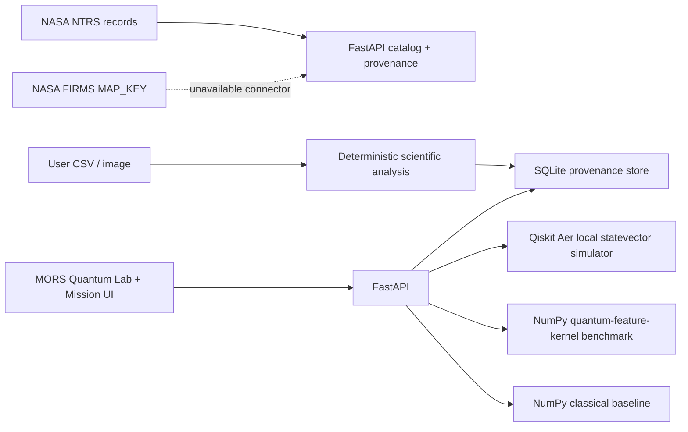

# MORS AEGIS — architecture and scientific scope

## Application path

## Implemented scientific paths

- NASA NTRS records and abstracts are catalogued with original source links. No raw flame measurements are represented as ingested.
- User CSV time-series uploads are checked for schema, units, finite values, and timestamps; outputs include deterministic descriptive statistics and a median/MAD screen, with source hash and exportable provenance.
- RGB image analysis remains a clearly labeled exploratory threshold, not a trained or calibrated flame detector.
- Quantum circuits can be constructed from a bounded gate allowlist and run using local Qiskit Aer statevector plus seeded finite-shot measurement. Backend, seed, shots, circuit, content hash, amplitudes, counts, Bloch vectors, purity, execution timing, memory estimate and deterministic checks are reported and persisted.
- If Aer cannot import, the explicitly labeled local NumPy statevector implementation provides an offline classical simulator; backend output says which engine executed.
- A two-qubit fidelity feature-map kernel is benchmarked on caller-provided two-feature binary samples using leave-one-out kernel ridge; the classical comparator is a standardized RBF kernel with the same data split. This is a small demonstration, not NASA data or evidence of quantum advantage.
- A user-selectable MORS, Ocean, Ember, or Light appearance is stored in local browser storage. The provided MORS mark is rendered as a local SVG asset. Appearance settings never alter measurements.

## Quantum simulation contract and limitations

API routes:
- `GET /api/quantum/status` reports simulator package availability, run count, limits and explicit hardware-disabled status.
- `POST /api/quantum/circuits/run` accepts at most eight qubits, a maximum of 64 gates, and 128–8192 shots. Supported gates are H/X/Y/Z/RX/RY/RZ/CX/CZ/SWAP. Rotation angles are finite radians in `[-2π, 2π]`.
- `POST /api/quantum/benchmarks/kernel` accepts 4–128 two-feature samples and binary labels; source authenticity is not assumed.
- `GET /api/quantum/experiments` and `GET /api/quantum/experiments/{id}` inspect persisted run metadata/results.

The Aer execution backend is a classical statevector simulation. It is not an external QPU, cloud-provider execution, or physical quantum experiment. The fallback is a classical NumPy reference simulator. Ideal simulation excludes device noise, readout error, calibration, queue times, connectivity constraints and hardware resource behavior. Statevector memory is `16 × 2^n` bytes for complex128, before simulator overhead. Runtime measurements depend on host and software versions. There is no cloud quantum credential configuration, hardware authorization or execution.

The quantum kernel benchmark records one deterministic leave-one-out run and does not provide repeated-seed confidence intervals, hyperparameter search parity, independent held-out scientific data, error bars, or computational resource parity. It is an educational comparative experiment only. `quantum_superiority_claimed` is always false.

The single-qubit Bloch vector is computed from the reduced one-qubit density matrix. Entangled states consequently produce maximally mixed single-qubit vectors. Statevector JSON keys use circuit register order `q0...qN`; Qiskit count strings are reversed to match that same displayed order.

## Reproducibility and security

Quantum run input is validated at the API boundary and stored with an input SHA-256, seed, backend and result. Gate execution is deterministic; finite-shot outcomes use the explicit seed. No uploaded code or circuit expression is evaluated. Experiment history currently has no user authentication or per-user access control; this build is for a local demonstration, not multi-user or production confidential research.

Secrets supplied in a chat message or file are considered exposed and are not embedded in source, frontend assets, Docker image, or reports. Revoke and rotate exposed credentials at their provider; configure replacement values only through a protected runtime environment after a required connector has been implemented.

## References and unsupported tracks

The app does not currently feed the quantum kernel synthetic example from combustion measurements, satellite observations or astronaut telemetry. Those integrations require validated datasets and comparative protocols before domain claims. FIRMS requires a MAP_KEY, and this app has not implemented a live observation connector. NASA NTRS abstracts are literature evidence, not raw flight data.
